# An RTOS-Based Agentic System for Proactive Car Sickness Intervention

**Group: MerMaid** · ITE351 AI & Applications, Hanyang University (2026 Fall)

| Name | Department | University | Email |
|---|---|---|---|
| Seunghee Kim | Dept. of Information Systems | Hanyang University | ksh0401@hanyang.ac.kr |
| Yookyung Jung | Dept. of Information Systems | Hanyang University | diesel2580@hanyang.ac.kr |
| Junmin Lee | Dept. of Information Systems | Hanyang University | junemin03@hanyang.ac.kr |
| Hyeokjin Lee | Dept. of Information Systems | Hanyang University | dlgurwls0529@hanyang.ac.kr |

**🎬 Video presentation:** _TODO: add YouTube link_ <!-- e.g. [](https://www.youtube.com/watch?v=VIDEO_ID) -->

---

## Table of Contents

- [Abstract](#abstract)
- [I. Introduction](#i-introduction)
  - [A. Motivation](#a-motivation)
  - [B. Problem Statement](#b-problem-statement)
  - [C. What We Want to See at the End](#c-what-we-want-to-see-at-the-end)
- [II. Datasets](#ii-datasets)
- [III. Methodology](#iii-methodology)
  - [A. System Architecture](#a-system-architecture)
  - [B. Feature Extraction](#b-feature-extraction)
  - [C. Risk Models](#c-risk-models)
  - [D. Tiered Adaptive Intervention](#d-tiered-adaptive-intervention)
  - [E. Personalized Sensitivity](#e-personalized-sensitivity)
  - [F. Deployment on QNX](#f-deployment-on-qnx)
  - [G. Passenger-Facing Interfaces](#g-passenger-facing-interfaces)
- [IV. Evaluation & Analysis](#iv-evaluation--analysis)
- [V. Related Work](#v-related-work)
- [VI. Conclusion: Discussion](#vi-conclusion-discussion)
- [Team Roles](#team-roles)
- [Repository Structure](#repository-structure)
- [References](#references)

---

## Abstract

As electric and autonomous vehicles turn the car into a space for entertainment and relaxation, motion sickness is becoming a major obstacle to passenger comfort, especially for occupants focused on screens. Because motion sickness accumulates over time rather than depending only on instantaneous acceleration, the timing and type of intervention must be decided proactively. This project proposes a QNX-based embedded system, prototyped on a Raspberry Pi, that estimates motion sickness risk from vehicle acceleration and accumulated motion exposure using one ordinal gradient boosting model whose inputs include a mathematical motion sickness model. Based on the estimated risk, passenger context, and individual tolerance, the system escalates through three interventions (airflow, ambient direction cues, and visual motion dots) and coordinates in-vehicle and mobile devices through RF communication. The project aims to demonstrate the feasibility of proactive and personalized motion sickness intervention in an embedded vehicle environment.

**Keywords:** motion sickness, proactive intervention, QNX, embedded system, lightweight machine learning

---

## I. Introduction

### A. Motivation

Recent advances in electric vehicles (EVs), autonomous driving, and intelligent automotive technologies are changing the role of the automobile. Vehicles have traditionally served mainly as a means of transportation. As driving automation develops, however, passengers are expected to spend more time on non-driving activities such as watching videos, using personal devices, working, or relaxing. Cars are becoming personal spaces for entertainment and relaxation, which makes passenger comfort an increasingly important part of the in-vehicle user experience (UX).

**Motion sickness** is one of the major obstacles to this change. Unlike drivers, who can see upcoming changes in direction, acceleration, and deceleration, passengers often have little awareness of what the vehicle is about to do. The problem gets worse when passengers focus on smartphones or in-vehicle displays instead of the road. And as autonomous driving lets even would-be drivers do non-driving activities, motion sickness may come to affect every occupant.

The growing adoption of EVs adds further concerns. EVs have rapid torque response and regenerative braking, which produce acceleration and deceleration patterns different from those of conventional vehicles. Research has shown that stronger regenerative braking can increase motion sickness under certain driving conditions. So rather than relying only on driving behavior, we need a **proactive** system that identifies early signs of motion sickness and intervenes before symptoms get worse.

### B. Problem Statement

Motion sickness is commonly explained by **sensory conflict**: information from the vestibular system does not match visual information. When a passenger focuses on a smartphone in a moving vehicle, their vision is fixed on a stationary object and tells them they are not moving, while the vestibular system senses the acceleration, braking, and turning. This mismatch contributes to discomfort.

Motion sickness also does not depend only on instantaneous acceleration. Its severity **accumulates over time**, and how fast symptoms develop and recover varies widely between people. Detecting a sudden movement alone is therefore not enough. A better approach must consider accumulated motion exposure, exposure duration, and individual sensitivity.

Existing comfort features usually react to vehicle motion or offer one specific kind of assistance. They do not decide *when* an intervention is needed or *which* response is most appropriate. From the passenger's point of view:

- uncomfortable motion conditions should be detected **before** symptoms become severe;
- help should come **without interrupting** ongoing activities;
- intervention intensity and timing should **scale progressively** with the estimated risk.

This calls for an integrated system that collects vehicle motion data, assesses motion sickness risk, and coordinates several in-vehicle comfort devices, while staying reliable and safe within the vehicle's embedded computing environment.

### C. What We Want to See at the End

At the end of the project we want an integrated prototype that demonstrates the full pipeline:

1. **Data acquisition**: vehicle acceleration from an IMU or prerecorded signals
2. **AI inference**: motion sickness risk estimated on a Raspberry Pi running QNX
3. **Decision-making**: three interventions switched on in order according to risk and passenger context
4. **Device control**: fan, HUD, and vehicle display driven automatically
5. **Mobile integration**: visual motion cues and manual override on the passenger's phone over RF

The main objective is to **demonstrate the feasibility of proactive, personalized, and automated motion sickness intervention in an embedded vehicle environment**. The selected dataset contains controlled one-axis motion stimuli without visual conditions or intervention outcomes. This project therefore focuses on validating **risk estimation and intervention triggers**, not on proving actual symptom reduction in real EVs.

---

## II. Datasets

We use two data sources:

- **Synthetic driving data** for training and structural experiments. Its labels are generated with the Oman model, so results on it show whether the structure works, not real-world accuracy.
- **TU Delft 2022 motion sickness dataset** (17 participants) to validate the acceleration-based core against real passenger reports.

> - Source / link and license
> - Number of participants and sessions
> - Motion stimulus: axis, frequency, amplitude, exposure duration, rest / re-exposure protocol
> - Recorded signals and sampling rate
> - Label: MISC (MIsery SCore) scale and how often it was reported
> - Class balance after defining our risk labels
> - Preprocessing steps (resampling, filtering, windowing, handling missing reports)

**Known limitations.** The dataset uses controlled **one-axis** motion stimuli. It has **no visual conditions** (e.g., screen use) and **no intervention outcomes**. As a result:

- screen-ON and screen-attention information are used as **activation conditions** for interventions, not as training features;
- the model is validated as a risk estimator and trigger generator, not as proof that interventions reduce symptoms;
- signals missing from the dataset (vehicle speed, CAN, navigation, and so on) come only from the simulator, so they prove that the model accepts these inputs, not that they improve accuracy.

---

## III. Methodology

### A. System Architecture

The system is implemented on a **Raspberry Pi running QNX**, acting as a prototype vehicle-side controller. It is split into modular components so that sensors, models, and comfort functions can later be replaced or extended without redesigning the whole system:

```mermaid
flowchart LR
  classDef done fill:#d1fae5,stroke:#059669,color:#064e3b
  classDef part fill:#fef3c7,stroke:#d97706,color:#78350f
  classDef plan fill:#f3f4f6,stroke:#9ca3af,stroke-dasharray:5 3,color:#374151

  subgraph PI["In the car · Raspberry Pi 4 · QNX 8.0 · C++17"]
    direction LR
    IMU["MPU-6050 IMU<br/>(not wired yet)"]:::plan
    P1["P1 Acquisition<br/>10 ms · prio 40<br/>replay + LIVE (fake IMU)"]:::part
    P2["P2 Features<br/>71 per 10 s · prio 30"]:::done
    P3["P3 Inference<br/>LightGBM ×5 · prio 20"]:::done
    P4["P4 Policy<br/>Tiers 1–3 · prio 15"]:::done
    P5["P5 Device manager<br/>prio 14"]:::done
    P6["P6 Communication<br/>UART ↔ QNX · prio 12"]:::done
    P7["P7 Logger<br/>prio 11 / 9"]:::plan
    CSV[("cycles.csv<br/>state/*.json")]:::done
    SD[("SD card<br/>rides/*.sqlite")]:::plan

    IMU -->|"I2C 100 Hz"| P1
    P1 -->|"Sample"| P2
    P2 -->|"VEH"| P3
    P3 -->|"RISK"| P4
    P4 -->|"TIER_CMD · DEV_SYNC"| P5
    P5 -->|"OUT_*"| P6
    P6 -->|"CTX_SCR/OVR/PROF"| P4
    P2 -->|"MOTION 100 ms"| P6
    P4 --> CSV
    P1 -.->|"shared-memory ring"| P7
    P3 -.->|"LOG_INFER"| P7
    P4 -.->|"LOG_DECISION"| P7
    P6 -.->|"LOG_CTX · LOG_SYM"| P7
    P7 -.-> SD
  end

  subgraph DEV["Devices"]
    ESP["ESP32-S3 bridge v8"]:::done
    APP["Passenger app (Android)<br/>SYM input planned"]:::part
    HUD["HUD · vehicle display<br/>(web)"]:::done
  end

  P6 <-->|"UART3"| ESP
  ESP <-->|"BLE"| APP
  ESP <-->|"BLE"| HUD

  subgraph OFF["Off the car · Mac · Python 3.12"]
    COL["collect_logs.py<br/>ssh"]:::plan
    SRV["Log server<br/>FastAPI + SQLite"]:::plan
    EXP["build_real<br/>--source mermaid"]:::plan
    SIM["Simulator"]:::done
    REAL["Real-drive converters<br/>comma2k19 · BATON · TU Delft"]:::done
    CAL["calibrate.py<br/>KS score"]:::done
    TRAIN["featurize → train.py"]:::done
    RUNS[("runs/vNNN<br/>deployed v007")]:::done
    LLM["Claude loop"]:::plan
  end

  SD -.-> COL
  COL -.-> SRV
  SRV -.-> EXP
  EXP -.-> TRAIN
  SIM --> TRAIN
  SIM --> CAL
  REAL --> CAL
  CAL -->|"parameter fit"| SIM
  TRAIN --> RUNS
  RUNS -->|"runs.py use → models · thresholds"| P3
  SRV -.->|"summary stats"| LLM
  LLM -.->|"sim parameter proposals"| SIM
```



Green: working · amber: partly built · gray dashed: planned (see [docs/controller/DATA_LOGGING.md](docs/controller/DATA_LOGGING.md) for the logging and log-server design).

### B. Feature Extraction

Features are grouped by where they come from: 77 values in 10 groups. The IMU and system clock are always available, and the rest (vehicle speed, CAN, navigation, climate, and so on) are added as far as the vehicle provides them. A missing signal is passed as NaN. Motion is measured over short and long windows, alongside values accumulated over the ride such as MSDV and the Oman model's estimated sickness score.

### C. Risk Models

There is **one model**, not one model per tier. It estimates how far the passenger's sickness is likely to go within the next 5 minutes, and the tiers are decisions made on that estimate.

- **Oman model.** A physiologically motivated model of how motion sickness accumulates and recovers over time. Its output is an input feature.
- **Ordinal LightGBM.** Predicts the probability that the maximum MISC score reaches each level. Trees handle missing signals directly and are fast on an embedded CPU.
- **Group dropout.** Whole feature groups are blanked during training, so the same model runs on vehicles with different equipment.

### D. Tiered Adaptive Intervention

The higher the cost of a wrong activation, the more certainty, the longer confirmation, and the narrower conditions a tier requires.

| Tier | Intervention | Device | Confirmation | Extra condition |
|---|---|---|---|---|
| 1 | **Airflow** (fan) | Shared | 10 s | None |
| 2 | **Ambient direction cue** (HUD) | Shared | 1 min | HUD screen on |
| 3 | **Visual motion dots** | Each passenger's phone | 2 min | Screen on and attention |

Confirmation is how long the risk must stay above the tier's threshold before the device turns on (`hold_cycles` in `controller/config/policy.json`, one cycle = 10 s).

Passengers can **manually override** any automatic intervention. The system never controls steering, braking, or other safety-critical driving functions.

### E. Personalized Sensitivity

People differ in both how easily they get sick and how much intervention they will accept. The passenger's motion sickness survey (the MSSQ score and the sensitivity computed from it) is a model input, so a new passenger is personalized from the survey alone. Adjustments learned while riding stay outside the model: if a passenger quickly turns off an intervention, that tier's threshold rises for future activations, and a per-person calibration fitted from ride logs (planned) shifts that passenger's predicted risk.

### F. Deployment on QNX

Training runs on a development PC (Python, LightGBM). The trained model files are copied to the Raspberry Pi, where a LightGBM library built from source on QNX runs inference alongside decision-making and device control. PC and QNX results are compared on identical inputs; on a small test model they matched.

### G. Passenger-Facing Interfaces

- **Mobile app:** receives intervention commands from the controller, shows visual motion cues synchronized with vehicle movement, lets the passenger override interventions, and sends screen-state information (screen on, app in foreground) back.
- **Vehicle display UI:** shows visual motion dots and current intervention status.
- **HUD:** a separate view of the vehicle screen app that shows the ambient acceleration-direction cue. It is drawn on a black background with an optional mirror mode, so a phone or tablet placed under a tilted acrylic sheet or the windshield works as a reflective HUD. The cue shows only the direction of vehicle acceleration, so it does not need to be registered to the road like an AR-HUD.
- **Communication:** bidirectional RF (Wi-Fi or Bluetooth) between controller and phones, with failure detection and a fallback over a wired connection to an external wireless router.


---

## IV. Evaluation & Analysis

**Evaluation plan.**

- **Person-level cross-validation**: no person appears in both training and test folds, which measures generalization to unseen passengers.
- **Classification metrics**: PR-AUC and ROC-AUC, plus precision and recall for each tier.
- **Robustness**: performance with feature groups blanked, compared with a model trained on the IMU and clock alone, and across EV and combustion vehicles.
- **Real-data check**: the acceleration-based core against the TU Delft reports.
- **Deployment consistency**: compare PC (Python) and QNX (LightGBM C API) outputs on identical inputs.
- **System behavior**: replay journeys through the policy layer and measure detection rate, lead time, and false activations per hour for each tier.

---

## V. Related Work

**Commercial solutions.** Apple's **Vehicle Motion Cues** uses device sensors to detect vehicle motion and shows animated dots along the edges of the iPhone or iPad screen to reduce sensory conflict. Our system takes a **vehicle-centered** approach instead: a central controller evaluates risk and coordinates several interventions (airflow, ambient cues, motion dots), and it accounts for accumulated exposure and individual sensitivity rather than applying the same response to everyone.

**Research.** Irmak et al. studied how acceleration amplitude and exposure duration relate to motion sickness development in controlled motion experiments. Their findings show time-dependent accumulation and recovery dynamics and the importance of individual sensitivity, which supports using the Oman model's output as an input to lightweight ML.

**Tools and libraries used.**

> - Python, NumPy, pandas, scikit-learn, LightGBM, matplotlib
> - QNX Software Development Platform, Raspberry Pi
> - IMU sensor model, fan driver
> - Mobile app framework
> - Blogs / documentation consulted

---

## VI. Conclusion: Discussion

> **TODO (team):** summarize what the prototype achieved, key results from Section IV, and lessons learned.

**Limitations.**

- Training labels on the synthetic data are generated by the Oman model, so those results do not show real-world accuracy.
- The real data uses one-axis, controlled lab motion, not real multi-axis driving.
- No visual conditions or intervention outcomes are in the data, so we validate risk estimation and triggers rather than actual symptom reduction.

**Future work: EV-specific mitigation.**

- Add EV-specific motion features such as jerk and the patterns caused by rapid torque response and regenerative braking, and refine models with real EV driving data.
- Combine camera-based analysis of head movement and visual attention with acceleration-based prediction in a **multimodal** model.
- Validate with real-world EV drives and passenger responses.

---

## Team Roles

| Name | Role | Responsibilities |
|---|---|---|
| Seunghee Kim | Back-end Developer, AI Developer | Trains the ordinal GBM risk model, evaluates it with person-level CV, deploys inference with LightGBM on QNX, integrates the tiered intervention policy |
| Hyeokjin Lee | AI Developer, User / Customer | Defines passenger scenarios and validates requirements; preprocesses the TU Delft dataset, extracts features (RMS, MSDV), implements the Oman model and personalized sensitivity |
| Yookyung Jung | Back-end Developer, Server Manager | IMU data acquisition, fan / display control, RF communication, runtime environment, communication reliability and fallback |
| Junmin Lee | Front-end Developer, UI/UX Designer | Mobile app and vehicle display UI: visual motion dots, intervention status, HUD view, manual override |

---

## Repository Structure

```
.
├── README.md
├── docs/                    # documents
│   ├── proposal/            # Phase 2 proposal, requirements and screen definitions (ui/)
│   ├── architecture/        # SPEC.md, ARCHITECTURE.html (built by make_architecture.py)
│   ├── controller/          # RF_MESSAGES.md, DATA_LOGGING.md (controller-side designs)
│   └── ml/                  # DATASETS.md, REALDATA.md
│
├── protocol/                # the contract shared by controller, bridge, apps, ML and server
│   ├── PROTOCOL.md          # UART frames, BLE GATT, messages, device IDs
│   ├── messages.schema.json # JSON Schema for the messages
│   ├── ride_schema.sql      # P7 ride file (SQLite) tables, written by the controller, read by the server
│   ├── uuids.json           # BLE service / characteristic UUIDs
│   ├── constants.json       # Oman, Wf, event, rest and MSSQ constants
│   ├── trip_format.json     # columns of the 100 Hz trip.bin
│   ├── feature_order.json   # 77 features: order, group, unit, window, monotone, enabled
│   ├── gen_cpp.py           # JSON + SQL → controller/common/protocol_gen.hpp
│   └── check.py             # validates the files above
│
├── controller/              # QNX C++ on Raspberry Pi 4: processes P1–P7
│   ├── CMakeLists.txt       # cmake -S controller -B build (Mac and Pi)
│   ├── common/              # portable C++: features, inference, policy, comm, ride log, calibration
│   ├── qnx/                 # P1–P7 processes and run scripts
│   ├── config/              # policy.json, thresholds.json, imu_mount.json
│   ├── tools/               # featurize, policy_replay, calib_apply, verify_model, csv2bin.py
│   ├── tests/               # unit and process tests (ctest), qnxsim (QNX message passing on Mac)
│   └── bringup/             # hardware bring-up (MPU-6050, UART) and recordings/
│
├── firmware/
│   └── bridge/              # ESP32-S3 BLE <-> UART bridge (Arduino)
│
├── apps/
│   ├── android/             # passenger app (Kotlin)
│   └── hud-web/             # vehicle display, HUD and web demo of the passenger app
│
├── ml/                      # Python, development PC
│   ├── oman.py, wf.py       # reference Oman model and ISO Wf filter
│   ├── trip.py, runs.py     # trip.bin / features.bin I/O, versioned run folders (out/runs/vNNN)
│   ├── simulator/           # synthetic trips, passengers, Oman labels -> dataset
│   ├── realdata/            # comma2k19, BATON and MerMaid ride files -> real datasets
│   ├── train/               # LightGBM training and policy replay
│   ├── verify/              # Oman on TU Delft, model parity, pipeline check, TU Delft replay
│   ├── personal/            # personal calibration (a, b per passenger)
│   ├── tests/               # unit tests and C++ vs Python golden tests
│   └── data/                # raw datasets and trip files, not committed (see ml/data/README.md)
│
└── server/                  # log server (FastAPI + SQLite)
    ├── app.py, db.py, ridefile.py
    ├── .env.example         # settings (API key, data folder, upload limit)
    ├── tools/               # collect_logs.py: car -> server upload, calibration push
    └── tests/
```

---
